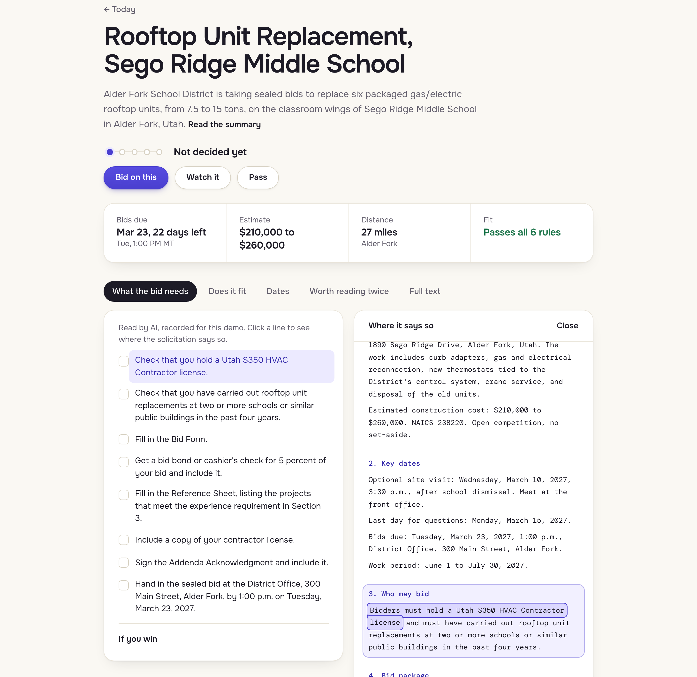
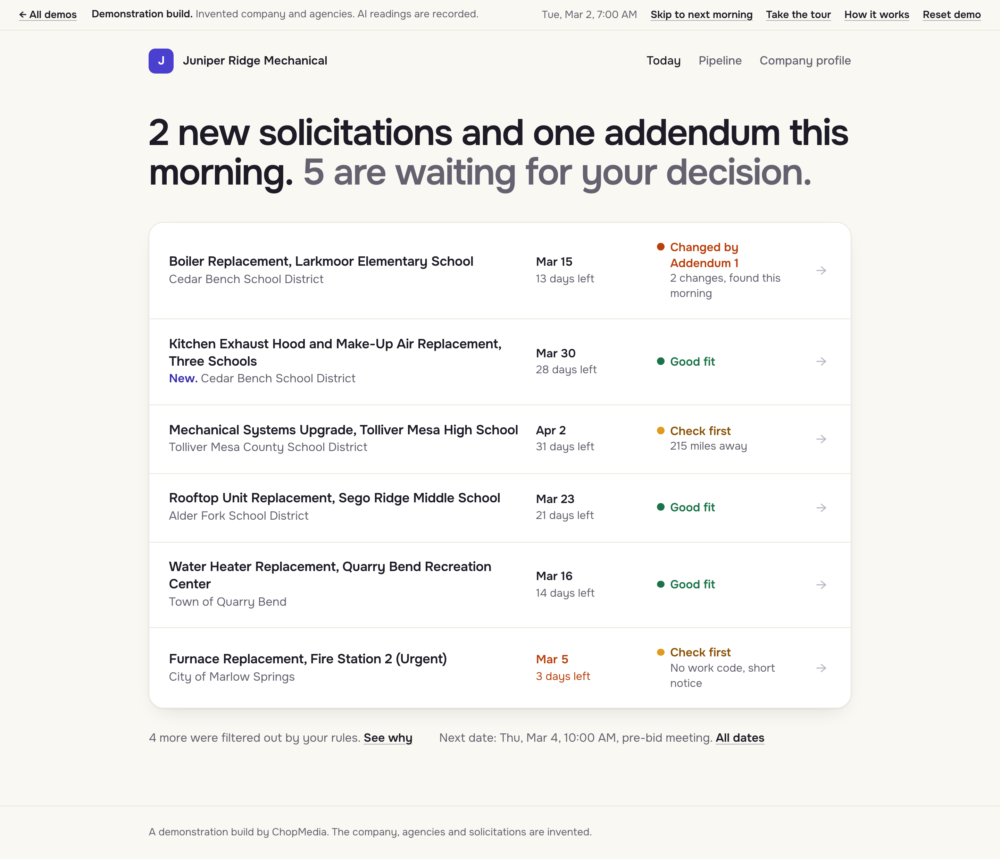
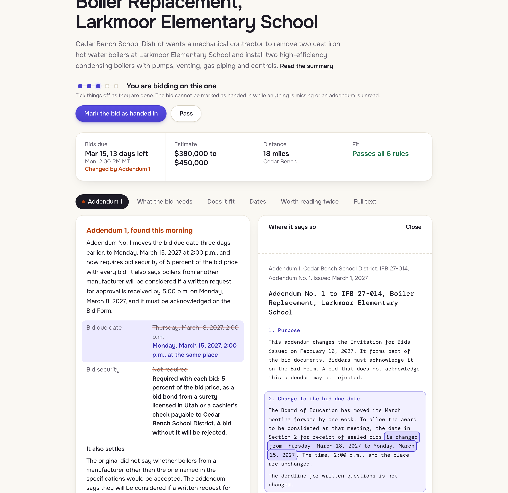
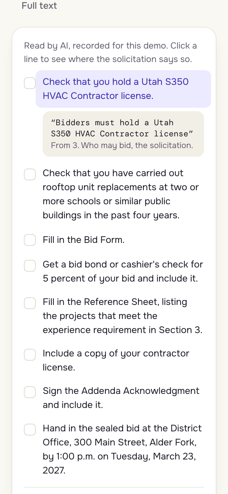
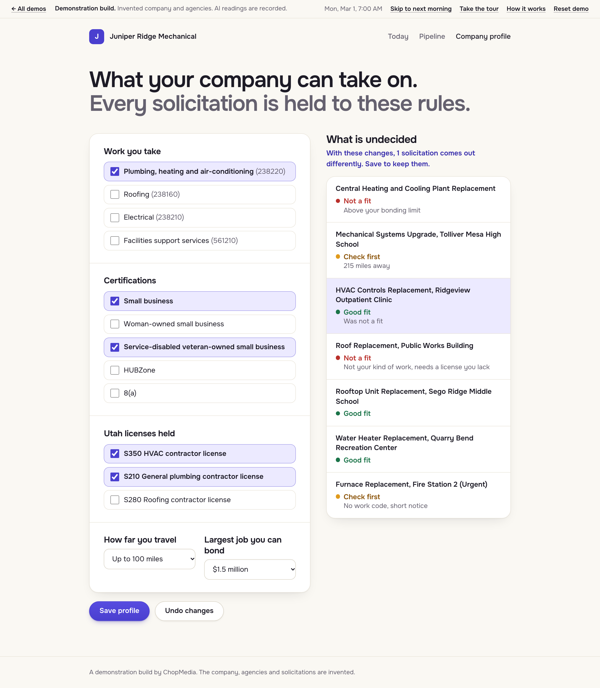

# Government bid tracker

Each morning's new government solicitations are read by AI, checked against what your company can take on, and turned into a checklist for the ones you bid. When an agency changes the rules midway, the change is caught and shown before and after. Every item points to the words it came from.

> **Demo project.** This is a demonstration build by ChopMedia, not client work. Juniper Ridge Mechanical is a fictional contractor. Every agency, solicitation, addendum, name, address and phone number is invented. The AI readings were recorded ahead of time and are replayed; the demo does not call an AI model while you use it, and it is not connected to any government website.



**Live demo:** https://government-bid-tracker.vercel.app

## The problem

A small contractor that wants public work has to watch a dozen places where agencies post it: a federal site, a state portal, and the purchasing pages of every district, city and county within driving distance. Most of what is posted is not for them. It is the wrong trade, set aside for a kind of business they are not, too big to bond, or too far away. Finding the few that fit means opening every one.

Then the real risk starts. A solicitation is thirty pages, and the things that get a bid thrown out are scattered through it: a mandatory meeting, a form that must be notarized, a bond, a license copy. And agencies issue addenda. A deadline moves up three days, a bond is added, and the notice goes to a web page nobody at the company was watching. The bid arrives late or incomplete, and weeks of estimating are wasted.

## What it does

- **Reads each solicitation into what a bidder needs to know.** A plain summary, the dates, the bonds, the licenses, who may bid, and how the bid is handed in.
- **Shows where it says so.** Click any date, fact or checklist item and the words it was read from light up in the solicitation beside it. On a phone, the quoted words appear under the item.
- **Sorts by fit using written rules, not more AI.** Work type, set-asides, licenses, bonding limit, distance and time left are each compared with the company profile. Jobs that do not fit are filtered out with the reason shown, so you can check the rule was right.
- **Turns a decision to bid into a checklist** of everything the bid must include. A bid cannot be marked as handed in while something is missing.
- **Catches addenda.** A change to something you are following goes to the top of the morning page, with what it said before and what it says now. New requirements join the checklist, and the bid cannot be handed in until someone has read the addendum.
- **Keeps the trail.** Why you passed on a job, when each item was done, and when each addendum was acknowledged are kept with the solicitation.

## Try it

Three things worth clicking first:

1. Open the **rooftop unit job** on Today and click anything under **What the bid needs**. The sentence it came from lights up in the solicitation.
2. Press **Skip to next morning** in the bar at the top. Overnight, a school district has moved a deadline three days earlier and added a bond on a bid that is already in progress. Open it and try to mark the bid as handed in.
3. Open **Company profile** and widen how far you travel or tick **Service-disabled veteran-owned small business**. The list beside the form shows which jobs come out differently before you save.

**Reset demo** in the top bar puts everything back.



| The addendum, with its source | The same checklist on a phone |
| --- | --- |
|  |  |



## What is recorded and what is real

**Recorded: the AI reading.** Each sample solicitation and addendum was given as text to Claude, an AI model made by Anthropic, with the instructions in [`content/READING-INSTRUCTIONS.md`](content/READING-INSTRUCTIONS.md). What it wrote was saved: the summary, the facts, the checklist, and its notes on anything a careful reader should look at twice. The demo replays those saved readings. They were not edited by hand, and where a note needed rewording the model was asked again. There are no confidence percentages on screen because the model did not give any, and none were invented. Replaying is what lets the demo run for free with no API key.

**Scripted: what arrives each morning.** The demo has its own calendar, starting on Monday, March 1, 2027. Which solicitations and addenda turn up on which morning is fixed in advance, standing in for a real check of agency websites.

**Real: everything after the reading.** The fit rules, the profile, the decisions, the checklists, how an addendum changes the dates and requirements, the rule that stops an incomplete bid being handed in, and the history all run live on your own private copy of the sample data.

## How it would plug into a real business

- **Real feeds.** Federal opportunities come from the SAM.gov opportunities API, which is free with a registered key. State and local postings come from the state purchasing portal and from each agency's own bid page, by feed where one exists and by a scheduled check of the page where it does not. Each source is one small adapter that hands over the solicitation text and its attachments.
- **A live AI reading** of each new posting and addendum as it is found, using the same instructions, tested first on solicitations the company has already bid so the readings can be compared with what the estimators know was required.
- **The company's own rules.** The fit rules are short functions over the profile. A real build adds the ones that matter to the firm: agencies it will not work for, bonding already committed to other jobs, crews already booked.
- **Alerts where people already look.** An email or text the morning an addendum lands, and a reminder ahead of each mandatory meeting and deadline.
- **Sign-in and roles.** The demo has no accounts because every visitor gets a private copy. A real build has sign-in, and records who decided, who ticked each item and who acknowledged each addendum.

## What this demo is not

- It is not connected to SAM.gov, any state portal or any agency, and it is not affiliated with one. No real solicitation appears in it.
- It is not a measure of accuracy. Fourteen invented solicitations say nothing about how a model reads real ones, which are longer, messier and often scanned. The way to find out is to run it on solicitations you have already bid, and that is the first step of a real project.
- It does not replace reading the solicitation. The checklist is a reading aid with its sources attached, so that checking it is quick. The bidder is still responsible for the bid.
- It does not give legal or bonding advice, write proposals, or price jobs.
- There are no usage numbers, clients or testimonials, because it is a demonstration.

## Tech stack and architecture

Next.js 16 (App Router, React 19, TypeScript), Tailwind CSS 4, Drizzle ORM on Postgres, Zod, Vitest.

```
content/                    the invented solicitations and addenda, as text,
                            and the instructions the AI was given
scripts/build-documents.mjs turns the texts into the sections the app shows
src/
  app/                      pages: Today, a solicitation, pipeline, company profile,
                            how the demo works
  components/
    solicitation.tsx        the solicitation screen: checklist, dates, addenda,
                            and the document with its highlights
    profile-form.tsx        the profile, with a live preview of what it changes
  data/
    readings/               what the AI read from each text, saved
    documents.json          the texts, split into sections
  lib/
    reading.ts              the shape a reading must have
    effective.ts            the facts in force after any addenda
    fit.ts                  every fit rule, as plain functions
    feed.ts                 what arrives on which demo morning
    calendar.ts             the demo's calendar and deadlines
  server/
    workflow.ts             every state change: decide, tick, acknowledge,
                            hand in, record the result, next morning
    actions.ts              thin server actions over the workflow
    queries.ts              what each screen reads
  db/                       schema, seed data, per-visitor sandboxes
```

Decisions worth knowing about:

- **The AI reads, rules decide.** Whether a job fits is never the model's call. It is decided by rules a contractor can read, each giving its reason in plain words.
- **Every item carries its source.** A reading is only accepted if each fact and checklist item names a section of the text and quotes words from it. A test confirms every quote appears, word for word, in the section it names, so a highlight cannot point at nothing.
- **An addendum is laid over the original, not merged into it.** The original reading is never changed. The facts in force are worked out each time from the original plus the addenda found so far, which is what makes the before and after possible.
- **The same fit code runs in the browser and on the server.** The profile page previews a change as you make it. The server runs the same rules on every page.
- **The rules that protect a bid are enforced on the server.** Handing in with items missing, or with an addendum unread, is refused there and not only by a disabled button.
- **Every visitor gets their own sandbox.** A cookie names a private copy of the sample data, created on first visit and deleted after 48 hours.
- **No paid services and no keys.** Locally the app runs on an embedded Postgres (PGlite) stored in `.data/`. With `DATABASE_URL` set it uses a normal Postgres server.

## Run it locally

Needs Node.js 20.9 or newer.

```bash
npm install
npm run dev
```

Open http://localhost:3000. The database is created and filled with sample data on first visit. No settings are required.

```bash
npm test            # unit and workflow tests
npm run typecheck
npm run lint
npm run db:reset    # delete the local database and start fresh
```

To use a Postgres server instead of the embedded database, set `DATABASE_URL` to its connection string and run `npm run db:migrate`.

If a text in `content/` is changed, run `npm run documents` to rebuild the sections. The saved reading in `src/data/readings/` belongs to the text as it was read, so a changed text needs a new reading.

---

Built by ChopMedia. Contact Hayden Huelskamp at chopscales@gmail.com, or on [LinkedIn](https://www.linkedin.com/in/hayden-huelskamp-547a86302/).
